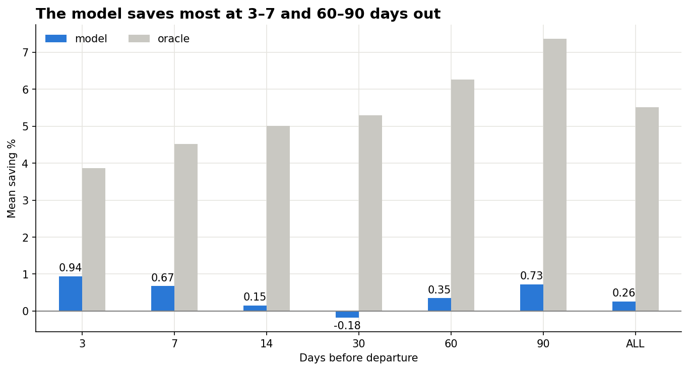
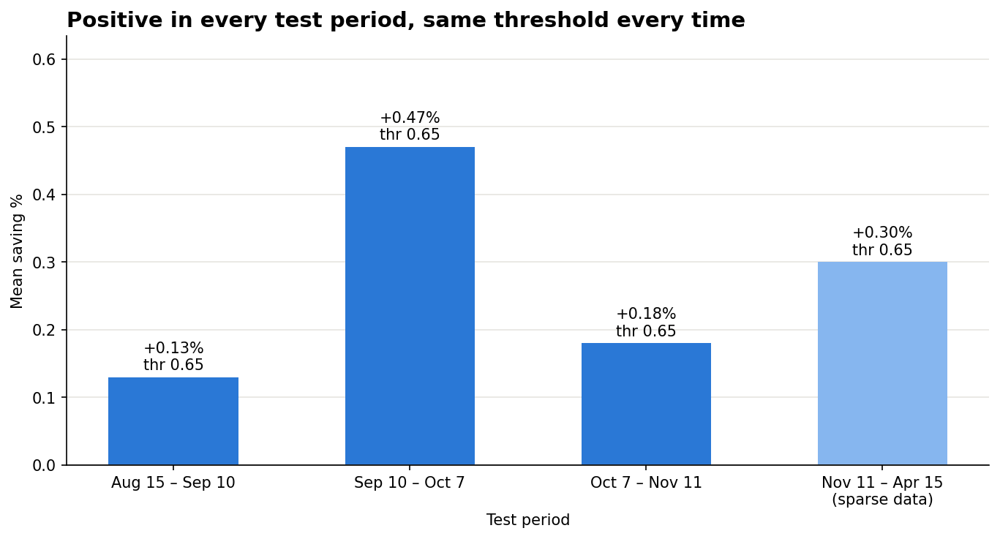
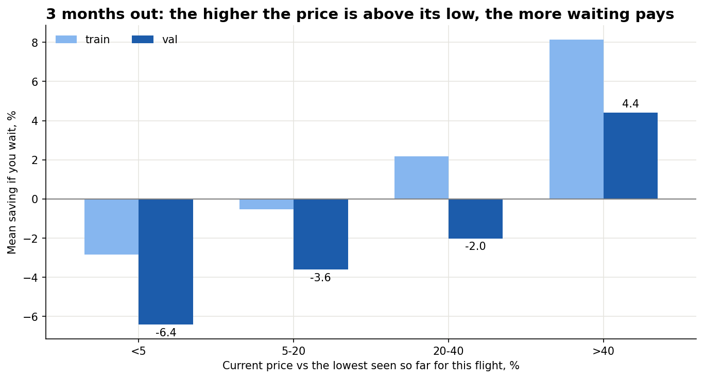
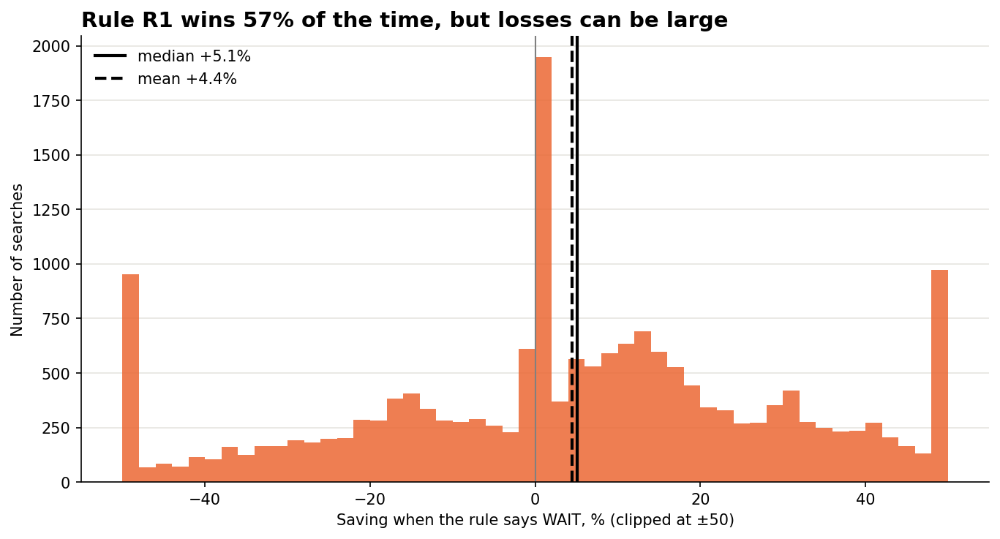

# Buy now or wait? Predicting flight price drops

I wrote my own Google Flights client library ([`google-flights` on PyPI](https://pypi.org/project/google-flights/)),
used it to collect **~13M price observations** for ~1M flights over 10 months,
and tested whether a model (or a simple rule) can tell you when it's worth waiting for a cheaper ticket.

**Short answer:** waiting by default is a bad idea, flight prices mostly go up. A model can find the
rare cases where waiting pays off and save a small but **consistent** amount, positive in every test period.
There is also one simple rule that works without any model.



---

## The question

You see a flight price today. **Buy now, or wait?**

"Wait" here means something a real person can do: **set a price alert at −3% and wait up to N days**
(3–20 days, depending on how far away the flight is). If the price drops, you buy at that price.
If not, you buy at whatever the price is when the window ends.

Every decision is scored by **% saved compared to buying immediately**:
- `always buy` = 0% (baseline)
- `always wait` = what happens if you always set the alert and wait
- `oracle` = buying at the lowest price in the window (perfect foresight, the ceiling)

## Data

| | |
|---|---|
| Source | Google Flights, via my library [`google-flights`](https://github.com/hexus07/google_flight_scraper) (builds the Protobuf `tfs` query and decodes the response, no browser needed) + the collection script in [`scraper/`](scraper/) |
| Period | May 2025 – Apr 2026 (scrape dates) |
| Size | 12.97M labelled price observations, 1.07M flights, ~1,000 routes, 50 airlines |
| Routes | between European regions (Baltics, Nordics, Britain, Iberia, Western/Eastern Europe) and US hubs |

The full SQLite database (~2.8 GB) is not included. A small sample is in `scraper/prices_latest.parquet`.

## Results

### 1. Always waiting loses money
Waiting by default loses **13–27%** on average: prices mostly rise as departure gets closer.
A useful model has to say "wait" rarely, and only when it's confident.

### 2. The model saves a small but stable amount
A LightGBM classifier, **weighted by how much money is at stake** (missing a 20% drop costs more than missing a 1% drop),
says "wait" on ~9% of searches.

To check that it wasn't one lucky split, I re-ran the whole pipeline on **4 consecutive time periods**
(train on the past, tune the threshold on the next month, test once on the period after):



| Test period | Model saving | Oracle (ceiling) |
|---|---|---|
| Aug 15 – Sep 10 | +0.13% | 5.80% |
| Sep 10 – Oct 7 | +0.47% | 5.56% |
| Oct 7 – Nov 11 | +0.18% | 5.17% |
| Nov 11 – Apr 15 *(sparse scraping)* | +0.30% | 5.31% |

- **Positive in all 4 periods.** Validation picked the **same threshold (0.65) every time**.
- Best close to departure (3–7 days) and far out (60–90 days).
- The model captures ~5% of the theoretical ceiling, so most price drops are simply not predictable from this data.

### 3. A simple rule that works without a model

> **If the flight is ~3 months away and the price is 40%+ above the lowest you've seen for it,
> don't buy. Set a −3% alert and wait.** Otherwise, buy.



On the two out-of-sample periods it paid off in **55–68%** of cases, with a median saving of **+3% to +14%**.
The catch: it applies to less than 1% of searches, and when the alert never fires, you can pay a lot more.



## What didn't work

Kept on purpose, because negative results are results too:

- **A separate threshold per horizon:** better on validation, not on test. It overfits one period.
- **Regression** (predict the % saving directly): not better than the classifier, and combining them didn't help.
- **Airline-specific rules** (United, American…): positive on validation, negative on train. Noise.
- **Re-asking the model at every price check:** loses money (−0.4%). The model is trained for one decision
  with a fixed waiting window, not as a daily oracle.

## Limitations

- **Seasons not seen in training** break long-horizon predictions: December holiday flights (Oct–Nov scrapes)
  behaved differently from anything in the summer training data.
- **The scraper ran irregularly** after Nov 2025 (every 4–8 days instead of daily), so some drops were missed.
- **~10 months of data**: each season appears at most once.

## Repository structure

```
scraper/
  scraper_refactored.py   # Google Flights scraper → SQLite
  regions.py              # regions, airports and route construction
notebooks/
  01_data_cleaning.ipynb  # cleaning, labelling, policy baselines, coverage
  01b_eda.ipynb           # when do prices drop? airlines, horizons, price curves
  02_model.ipynb          # model, rolling evaluation, simple rules
  figures/                # charts used in this README
```

## How to run

```bash
python -m venv venv
venv\Scripts\activate          # Windows
pip install -r requirements.txt

# scrape (writes to a local SQLite database)
python scraper/scraper_refactored.py --max_stops 0

# then run the notebooks in order: 01 → 01b → 02
```

## Tech

Python · pandas · LightGBM · matplotlib · SQLite · [`google-flights`](https://github.com/hexus07/google_flight_scraper) (my own library, published on PyPI)
